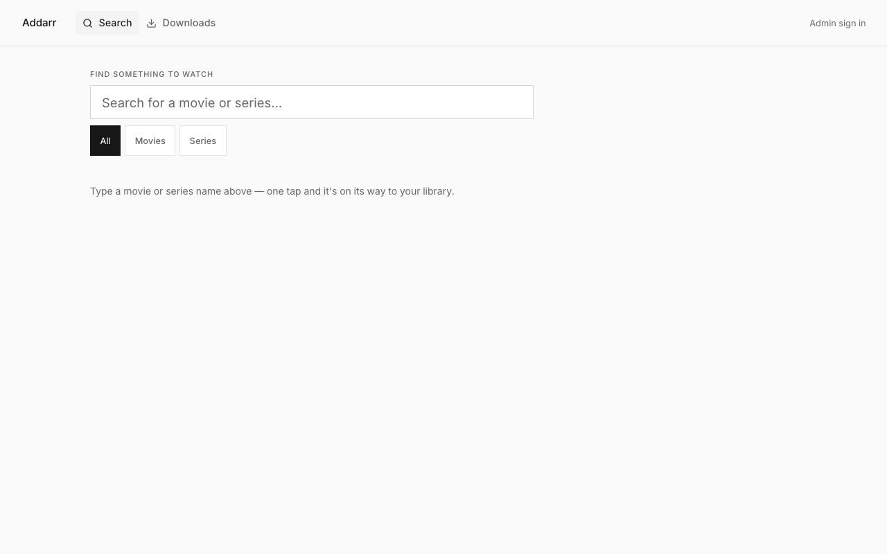
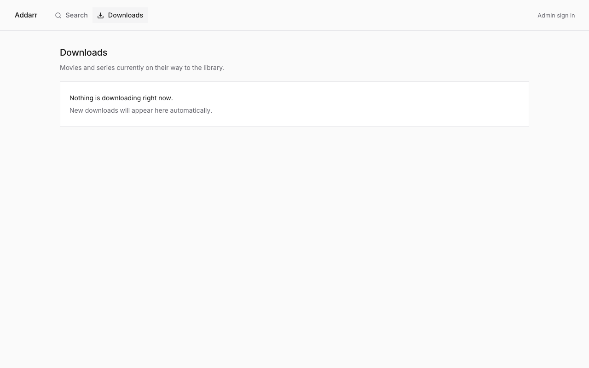
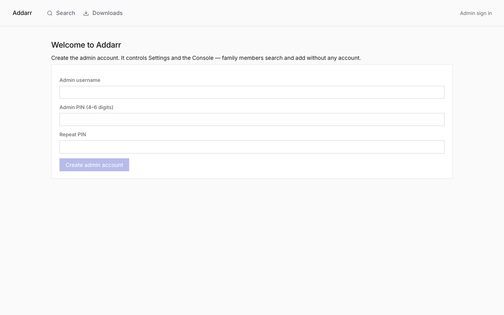

<p align="center">
  
</p>

# Addarr

One-tap movie and series adds for Radarr and Sonarr, built for the home LAN.

**1.0.0 · Node 22.18+ · Windows / macOS / Linux · MIT**

[](LICENSE)
[](https://nodejs.org)
[](#setup-windows--macos--linux)

Non-technical household members search for a title and tap **Add**. Done. An admin defines exactly what "Add" means and gets deep, curated control over the *arr instances. The browser only ever talks to Addarr. Radarr/Sonarr API keys live server-side and never reach the client.





*Screenshots from a fresh local run. Connect Radarr/Sonarr and the search view fills with a poster grid and one-tap **Add** buttons.*

- [What it is for](#what-it-is-for)
- [Features](#features)
- [Principles](#principles)
- [Setup (Windows / macOS / Linux)](#setup-windows--macos--linux)
- [First run](#first-run)
- [Sharing on your LAN](#sharing-on-your-lan)
- [Configuration](#configuration)
- [API](#api)
- [Docs](#docs)
- [For developers](#for-developers)
- [Security](#security)
- [Contributing](#contributing)
- [Acknowledgements](#acknowledgements)
- [License](#license)

## What it is for

- **Household members (no account needed).** Type a title, see a poster grid, tap **Add**. Watch it move from `queued` to `downloading` to `available` with a progress bar and time-left on the poster. "In library" badges stop duplicate adds.
- **The household admin.** Define what "Add" does per service with presets (quality profile, root folder, monitored, tags, minimum availability, search-on-add, plus Sonarr series type and season monitoring). Manage day-to-day acquisition from a curated console instead of the raw *arr UIs.
- **A shared library, not a request queue.** Unlike Ombi/Overseerr there is no approval workflow. A household does not need gatekeeping. Unlike the raw *arr UIs there is no jargon or destructive power in the member UI.

## Features

**Member mode**

- Search box with poster grid and one **Add** button, anonymous by design.
- "In library" badge plus live acquisition status after adding: `queued → downloading → importing → available`, plus `paused`, `partial`, and attention states.
- Poster progress bar with time-left and adaptive polling.
- **Downloads tab.** A household-wide, read-only view of everything in flight across Radarr and Sonarr, grouped one row per title. Tapping a download, or an in-library search result, opens the same detail sheet with progress, ETA, size, and episode counts, plus what is already on disk: one file for a movie, or downloaded episodes grouped by season.
Mobile-friendly: large touch targets, safe-area support, no iOS focus zoom.

**Admin presets**

- Per-service presets define everything Add does: quality profile, root folder, monitored, tags, minimum availability, search-on-add, and (Sonarr) series type plus season monitoring policy.
- The default preset powers the member Add button. A usable default is created automatically from the instance's first quality profile and root folder.
- Preset dropdown options are loaded live from the connected instance.

**Operations console**

- Curated screens for library edit/delete (typed confirmation), queue, history, import exclusions, blocklist, calendar, and hand-picked commands (`MoviesSearch`, `SeriesSearch`, `EpisodesSearch`, `RefreshMonitoredDownloads`).
- No free-form commands. No raw write access.

**Read-only escape hatch**

- `GET /arrapi/:service/<allow-listed path>` inspects any payload the curated UI does not show. Write verbs are structurally blocked.

**Activity log**

- Records who added what and when, plus admin actions.

## Principles

- **One tap, zero jargon.** The member UI never shows an *arr concept the admin preset has not already decided.
- **The browser is untrusted.** Keys and write power stay server-side; every exposed route is curated, allow-listed, and read-only by default.
- **Deep where the admin lives, shallow where members live.** Curated acquisition control beats raw API exposure; the read-only passthrough is the pressure valve, not the interface.
- **One process, one file, zero ceremony.** `npm start` remains the entire install, deploy, and update story.
- **LAN trust, honestly framed.** Designed for a trusted network rather than pretending to be internet-hardened.

## Setup (Windows / macOS / Linux)

### Requirements

- **Node.js 22.18 or newer** (an LTS release is fine), the only hard requirement. Check with `node -v`.
- **Git**, *optional.* It is only needed if you want to clone or update via git. Downloading a ZIP works just as well.

No database server, no build tools, no containers. `npm start` handles everything else: installing dependencies, building, and starting the server in the background.

### 1. Install Node.js

**Windows** (PowerShell):

```powershell
winget install OpenJS.NodeJS.LTS
```

Or download the installer from [nodejs.org](https://nodejs.org). Close and reopen your terminal afterwards so the PATH updates.

**macOS** (Terminal, with [Homebrew](https://brew.sh)):

```sh
brew install node
```

Or grab the `.pkg` installer from nodejs.org.

**Linux** (Debian/Ubuntu):

```sh
curl -fsSL https://deb.nodesource.com/setup_lts.x | sudo -E bash -
sudo apt-get install -y nodejs
```

Fedora: `sudo dnf install nodejs`. Any distro: [nvm](https://github.com/nvm-sh/nvm) works to get the latest Node.

### 2. Get the code

Any way you like, for example:

- **Download a ZIP.** On the GitHub repo page, **Code → Download ZIP**, then extract it and `cd` into the extracted folder in your terminal.
- **Clone** (requires Git):

  ```sh
  git clone https://github.com/edrickt/addarr.git
  cd addarr
  ```

### 3. Start it

In the folder containing `package.json`:

```sh
npm start
```

First run takes a minute; subsequent runs are faster. Updating later is the same: grab the latest code (re-download the ZIP or `git pull`) and run `npm start` again.

`npm start` installs Addarr as a **background service** and starts it. The server keeps running after you close the terminal and comes back when you log in. It also drops a desktop icon:

| Platform | Icon | Where it lives |
|---|---|---|
| macOS | **Addarr** app | `~/Applications`, Launchpad, Spotlight, Dock |
| Linux | **Addarr** app | applications menu (`~/.local/share/applications`) |
| Windows | **Addarr** shortcut + tray icon | Start menu, plus a notification-area icon while it runs |

Click the **Addarr** icon to start the server if it isn't running and open it in your browser. That is the everyday way in. The terminal is only needed for installing and updating. On Windows the running server also gets an **Addarr icon in the notification area** (bottom-right, behind the `^` chevron on Windows 11. Drag it out to keep it visible). Double-click to open. Right-click for restart, stop, log, and quit.

On Windows, allow Node.js through the Windows Defender firewall prompt if it appears (check both **Private** and **Public** networks if you will serve over LAN).

### 4. Open the app

`npm start` opens it for you. After that, use the **Addarr** icon or browse to `http://localhost:4545`. Other devices on your LAN use `http://<your-machine-ip>:4545` (find the IP with `ipconfig` on Windows, `ipconfig getifaddr en0` on macOS, or `ip addr` on Linux).

### Useful commands

```sh
npm run status                     # is it running?
npm run logs                       # follow the log (data/addarr.log)
npm run restart                    # restart the server
npm run stop                       # stop it until the next start, click, or login
npm run uninstall                  # remove the service and the icon (data/addarr.db is kept)
npm run start:foreground           # run in this terminal instead, with logs on screen
npm run dev                        # development mode with hot reload

PORT=8080 npm start                # different port (Windows PowerShell: $env:PORT=8080; npm start)
ADDARR_DB=/path/to/addarr.db npm start   # custom data file location
```

`npm start` bakes `PORT`, `HOST`, `ADDARR_LAN`, and `ADDARR_DB` into the background service, so re-run it to change any of those. `npm run start:foreground` is the "watch it work" mode; it needs the terminal to stay open.

## First run

1. Open `http://<host>:4545`. You land on **Setup**. Create the admin account (username + 4–6 digit PIN).
2. **Settings** → connect Radarr and Sonarr (URL + API key). A capability probe verifies the version before saving, and a usable default preset is created automatically from the instance's first quality profile and root folder.
3. Hand the household the URL; that is it. **Members need no account.** They search and add anonymously. Only signing into Settings/Console asks for the admin PIN (12-hour sessions, with a failed-attempt backoff against PIN guessing).

## Sharing on your LAN

By default Addarr binds to `localhost` only, so nothing else on the network can reach it. To share it, sign in as admin and go to **Settings → Network → Share on LAN**. When enabled, Addarr:

- becomes reachable from other devices at `http://<your-machine-ip>:4545` (the address is printed in the startup log), and
- broadcasts itself over mDNS/Bonjour as **"Addarr"**, so it shows up in network discovery (for example Safari's Bonjour list or an Avahi browser).

Enabling the setting takes effect for discovery immediately. If the server was started in localhost-only mode, one restart is needed to open the network bind. The app tells you when that is the case.

For headless setups you can also force it at startup: `npm start -- --lan` (or `ADDARR_LAN=1`), which overrides the in-app setting. `HOST=<addr>` binds a specific interface. Both are baked into the background service, so re-run `npm start` without them to hand control back to the in-app toggle. If mDNS is blocked on your network (some VPNs/containers), Addarr still runs; discovery just will not work.

**Tailscale note.** With "Share on LAN" on, Addarr listens on `0.0.0.0`, so it is also reachable over your Tailnet. The startup log used to lead with the `100.x` Tailscale address. It now lists the physical LAN address first, Tailscale last. To keep Addarr off the Tailnet entirely, bind just your LAN interface: `HOST=192.168.1.x npm start` (use your machine's LAN IP).

## Configuration

Data (users, sessions, connections, presets, activity log) lives in one SQLite file, `data/addarr.db` by default. Back that file up and you have backed up the whole app.

| Variable | Default | What it does |
|---|---|---|
| `PORT` | `4545` | Port the server listens on. |
| `HOST` | `localhost` | Bind address. Set to a LAN IP to share on one interface, or `0.0.0.0` for all interfaces. |
| `ADDARR_LAN` | `0` (`1` with `--lan`) | Force LAN sharing at startup, overriding the in-app toggle. |
| `ADDARR_DB` | `data/addarr.db` | Path to the SQLite data file. |

Values passed to `npm start` are baked into the installed background service. Re-run `npm start` (with or without them) to change what is baked in.

## API

Internal API. The browser talks to these routes. Radarr/Sonarr keys never leave the server.

| Route | Who | Does |
|---|---|---|
| `GET /api/search?service=movie\|series&q=` | member | trimmed poster-card lookup + in-library flag |
| `POST /api/add` | member | add via default preset, dedupe-checked, logged |
| `GET /api/status/:kind/:id` | member | polled badge: queued/downloading/importing/partial/paused/attention/missing/unreleased/available |
| `GET /api/downloads` | member | normalized, title-grouped active queue for the Downloads tab and detail sheet |
| `GET /api/files/:kind/:id` | member | on-disk file metadata: one movie file, or downloaded episodes grouped by season |
| `/api/presets` | admin | preset CRUD + live dropdown options |
| `/api/console/*` | admin | library, queue, history, exclusions, blocklist, calendar, curated commands |
| `/api/services`, `/api/activity` | admin | connections, activity log |
| `GET /arrapi/:service/*` | admin | allow-listed read-only passthrough |

See `PLAN.md` for the full architecture and milestone history.

## Docs

- [`PLAN.md`](PLAN.md) covers architecture, decisions, and milestone history.
- [`PRODUCT.md`](PRODUCT.md) covers users, positioning, capabilities, and brand commitments.

## For developers

Prerequisites: Node.js 22.18+.

```sh
git clone https://github.com/edrickt/addarr.git
cd addarr
npm install
npm run dev                        # dev mode with hot reload
```

Useful checks:

```sh
npm run check                      # svelte-check + types
npm test                           # node --test on the arr resource tests
npm run build                      # production build
npm run start:foreground           # production server in this terminal, logs on screen
```

Layout:

```text
src/routes/            member search + admin console, settings, setup, login
src/lib/arr/           per-service Radarr/Sonarr adapters + status normalization
src/lib/server/        auth, SQLite, presets, activity log
scripts/service.mjs    background-service installer (launchd / systemd / Windows Startup)
scripts/serve.mjs      production server entry
data/addarr.db         SQLite data file (created at runtime, not checked in)
```

### Tech stack

| Layer | Choice | Why |
|---|---|---|
| Runtime | Node.js + TypeScript | one language, huge ecosystem |
| Framework | SvelteKit (SSR) | server routes double as the internal API; minimal client JS |
| Database | SQLite via `node:sqlite` | zero-config, file-based, zero native deps |
| Styling | Plain CSS with semantic tokens | zero deps, full control for the Precision theme |
| Discovery | `bonjour-service` | mDNS/Bonjour broadcast as "Addarr" for LAN discovery |
| Fonts | Inter (self-hosted) | part of the Precision visual identity |
| Deploy | Single command launch (`npm start`) | install + build + per-user background service, OS-agnostic |

## Security

Addarr is designed for trusted networks. LAN access is opt-in (see [Sharing on your LAN](#sharing-on-your-lan)). For remote access, use Tailscale or WireGuard; there is no HTTPS hardening built in, by design.

API keys are held server-side in SQLite and are never sent to the browser. The only *arr passthrough is read-only and allow-listed; write verbs are structurally blocked. Admin sessions last 12 hours with backoff against PIN guessing.

## Contributing

Issues and pull requests are welcome. For bugs, include the server log (`npm run logs`), your OS and Node version (`node -v`), and the Radarr/Sonarr versions from Settings. For features, a short description of the member vs admin behavior helps more than a patch alone.

## Acknowledgements

- [Radarr](https://radarr.video) and [Sonarr](https://sonarr.tv) for the backends Addarr fronts.
- [SvelteKit](https://kit.svelte.dev), [Vite](https://vite.dev), and [Inter](https://rsms.me/inter/) for the app shell.
- [Tiled](https://www.mapeditor.org) for README inspiration: per-OS prerequisites and a clean install-vs-compile split.

## License

Copyright 2026 Edrick Tamayo.

Addarr is licensed under the MIT License. See [LICENSE](LICENSE).

Third-party dependencies keep their own licenses; see `package.json` and `package-lock.json` for the current list.
